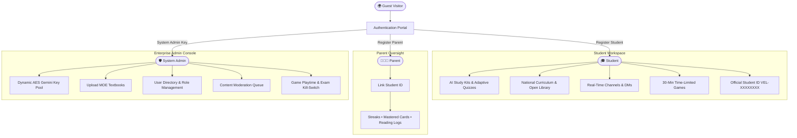
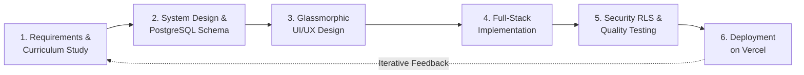
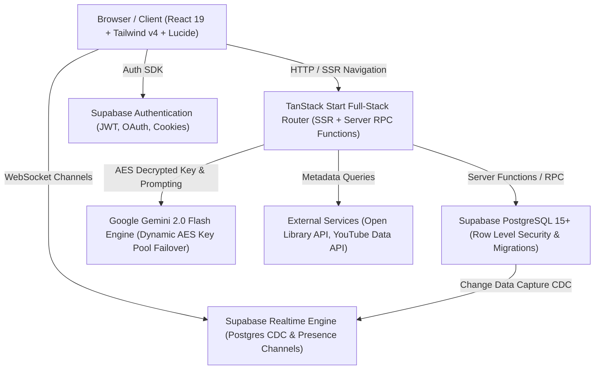
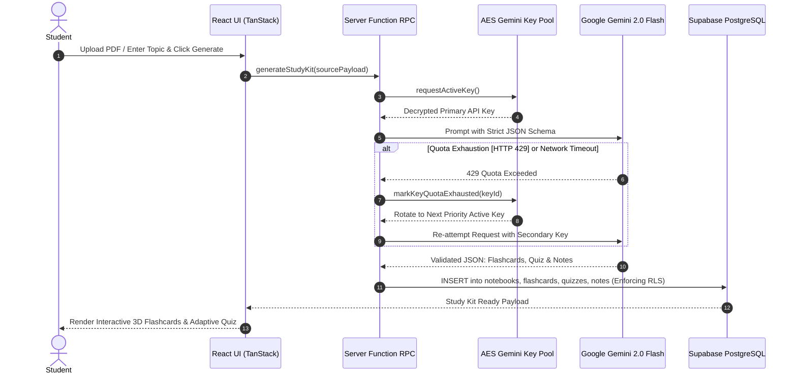
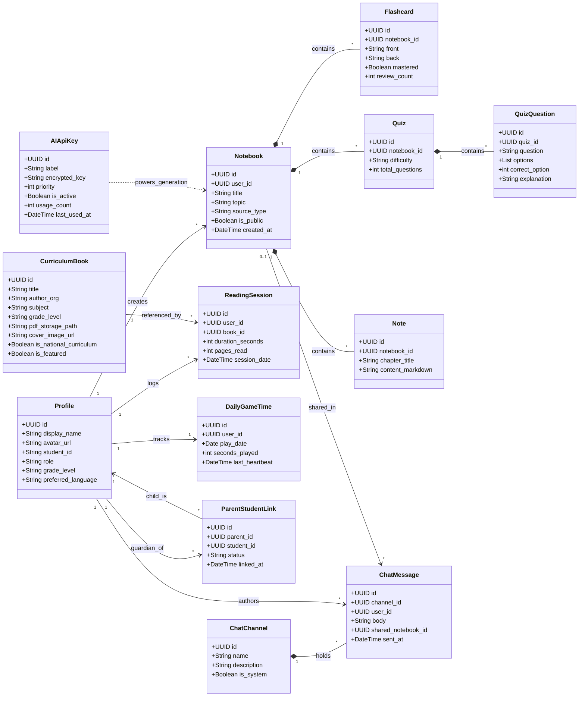

<div align="center">


# 📜 Vellum — Intelligent AI Study & Collaboration Platform

**Transform notes, textbooks, and curiosity into masterable knowledge.**  
Powered by **Google Gemini 2.0 Flash**, **TanStack Start (React 19)**, **Supabase PostgreSQL & Realtime**, and **Tailwind CSS v4**.

🎓 *Graduation Project — INSA Summer Camp 2026*  
**Developer:** Eserom Demissew &nbsp;•&nbsp; **ID:** CTC-7346-26 &nbsp;•&nbsp; **Classroom:** R-003

<br/>

[](https://vellumstudy.vercel.app)
[](https://eserom.vercel.app)
[](#-project-information)

[](#-acknowledgements)
[](#-project-information)
[](#-2-digital-library--ethiopian-national-curriculum)
[](#-4-study-break--brain-refresh-games-hub)

[](https://react.dev)
[](https://tanstack.com/start)
[](https://www.typescriptlang.org)
[](https://supabase.com)
[](https://tailwindcss.com)
[](https://aistudio.google.com)
[](https://vercel.com)
[](#-license)

<br/>

[🌐 **Live Demo**](https://vellumstudy.vercel.app) &nbsp;•&nbsp; [👨‍💻 **Portfolio**](https://eserom.vercel.app) &nbsp;•&nbsp; [✨ **Key Features**](#-key-features) &nbsp;•&nbsp; [📸 **UI/UX Showcase**](#-uiux-screenshots-showcase) &nbsp;•&nbsp; [🧩 **Architecture**](#-class-diagram--system-architecture) &nbsp;•&nbsp; [🚀 **Developer Guide**](#-developer-guide)

<br/>

<div align="center">
  
  <p><em>Vellum's intelligent landing page: multi-format study kit composer, interactive live quiz preview, and active-recall stats.</em></p>
</div>

</div>

---

## 📑 Table of Contents

1. [Project Information](#-project-information)
2. [Introduction](#-introduction)
3. [Statement of the Problem](#-statement-of-the-problem)
4. [Objectives](#-objectives)
5. [Key Features](#-key-features)
   - [1. Multi-Source AI Study Kit & Adaptive Quiz Engine](#1-multi-source-ai-study-kit--adaptive-quiz-engine)
   - [2. Digital Library & Ethiopian National Curriculum](#2-digital-library--ethiopian-national-curriculum)
   - [3. Real-Time Community & Interactive Study Kit Sharing](#3-real-time-community--interactive-study-kit-sharing)
   - [4. Study Break & Brain Refresh Games Hub](#4-study-break--brain-refresh-games-hub)
   - [5. Official Student Identity & Parent Oversight](#5-official-student-identity--parent-oversight)
   - [6. Self-Hosted Enterprise Admin & Multi-Key AI Pool](#6-self-hosted-enterprise-admin--multi-key-ai-pool)
   - [7. Multilingual Architecture & Native Amharic Support](#7-multilingual-architecture--native-amharic-support)
6. [System Users & Role-Based Access](#-system-users)
7. [Limitations](#-limitations)
8. [Methodology](#-methodology)
9. [Functional Requirements](#-functional-requirements)
10. [Non-Functional Requirements](#-non-functional-requirements)
11. [Future Enhancements](#-future-enhancements)
12. [Testing & Evaluation](#-testing--evaluation)
13. [Class Diagram & System Architecture](#-class-diagram--system-architecture)
14. [Technologies Used](#-technologies-used)
15. [UI/UX Screenshots Showcase](#-uiux-screenshots-showcase)
    - [Showcase 1: Public Experience & Multilingual Onboarding](#showcase-1-public-experience--multilingual-onboarding)
    - [Showcase 2: Account Creation & Authentication](#showcase-2-account-creation--authentication)
    - [Showcase 3: AI Study Kit Workspace & Adaptive Quiz Engine](#showcase-3-ai-study-kit-workspace--adaptive-quiz-engine)
    - [Showcase 4: Digital Library & Ethiopian National Curriculum](#showcase-4-digital-library--ethiopian-national-curriculum)
    - [Showcase 5: Real-Time Community Lounges & Study Kit Sharing](#showcase-5-real-time-community-lounges--study-kit-sharing)
    - [Showcase 6: Study Break Games & Heartbeat Limit Timer](#showcase-6-study-break-games--heartbeat-limit-timer)
    - [Showcase 7: Student Settings & Parent Oversight Dashboard](#showcase-7-student-settings--parent-oversight-dashboard)
    - [Showcase 8: Self-Hosted Enterprise Admin Console](#showcase-8-self-hosted-enterprise-admin-console)
16. [Unique Features](#-unique-features)
17. [Conclusion](#-conclusion)
18. [Acknowledgements](#-acknowledgements)
19. [Developer Guide](#-developer-guide)
20. [Contributing • License • Contact](#-contributing)

---

## 🏫 Project Information

<table>
<tr>
<td width="50%" valign="top">

### 👤 Student Information

| Field | Details |
| :--- | :--- |
| **Developer** | **Eserom Demissew** |
| **CTC Number** | **CTC-7346-26** |
| **Classroom** | **R-003** |
| **Program** | **INSA Summer Camp 2026** — Graduation Project |
| **Department** | Software Development / Cyber Talent Center |
| **Portfolio** | [eserom.vercel.app](https://eserom.vercel.app) |
| **GitHub** | [@eseromdemissew](https://github.com/eseromdemissew) |

</td>
<td width="50%" valign="top">

### 📦 Project Specifications

| Field | Details |
| :--- | :--- |
| **Project Name** | **Vellum** |
| **Full Title** | [Vellum — AI Study Notebooks, Flashcards & Practice Quizzes](https://vellumstudy.vercel.app/) |
| **Type** | Individual Capstone Graduation Project |
| **Category** | AI EdTech • Real-Time Collaboration • National Curriculum |
| **Development Status** | 🚧 Active Development / Production Release |
| **Live App URL** | [vellumstudy.vercel.app](https://vellumstudy.vercel.app/) |
| **Backend / DB** | Supabase Managed PostgreSQL + Realtime CDC |
| **Primary AI Engine** | Google Gemini 2.0 Flash (`gemini-2.0-flash`) |

</td>
</tr>
</table>

---

## 📖 Introduction

**Vellum** is a comprehensive, production-grade learning ecosystem engineered to revolutionize how students study, memorize, collaborate, and maintain healthy academic habits. The platform draws its name from *vellum* — the historical fine parchment revered for centuries as the medium used to preserve humanity’s most vital manuscripts and enduring knowledge.

Modern education faces a severe paradox: while academic content is overwhelmingly abundant, students are trapped in **passive consumption** (endless reading, re-reading highlights, and fragmented note-taking). Creating active-recall tools — such as flashcards, self-testing quizzes, structured revision summaries, and contextual Q&A — traditionally takes hours of manual effort that learners simply cannot spare.

Vellum eliminates this friction entirely. Utilizing **Google Gemini 2.0 Flash** paired with a type-safe **TanStack Start (React 19)** full-stack architecture and **Supabase Realtime**, Vellum converts arbitrary study material — uploaded PDFs, Word documents, text snippets, markdown files, or simple topic prompts — into a complete, interactive **active-recall study kit** within seconds:

1. **Active-Recall 3D Flashcards** with review/mastery tracking.
2. **Adaptive Multiple-Choice Quizzes** with instant explanations, score tracking, and on-demand difficulty scaling (*Easy, Medium, Hard, Mixed*).
3. **Structured Chapter Notes** organized by key concepts.
4. **"Ask Sources" Context AI Assistant** grounded strictly in the user's uploaded materials.
5. **Topic-Aware YouTube Video Recommendations** integrated into an in-app theater player.
6. **Curated Ethiopian National Curriculum Textbooks (Grades 9–12)** alongside Open Library access.
7. **Real-Time Public Lounges & Rich Study Kit Sharing** in chat channels.
8. **Student Identification System (`VEL-XXXXXXXX`)** with 1-click copy for Parent Portal linking.
9. **Brain Refresh Games Hub (20+ Games)** with a server-enforced daily playtime limit (30-minute heartbeat) and local midnight reset.
10. **Enterprise Self-Hosted Admin Portal** with AES-encrypted dynamic Gemini multi-key failover pooling, textbook uploader, and telemetry.

> **Graduation Milestone:** Vellum was designed, architected, developed, and deployed solo by **Eserom Demissew** as the capstone graduation project for the **INSA Summer Camp 2026** (Classroom R-003, CTC-7346-26).

---

## 🔍 Statement of the Problem

| # | Academic Problem | How Vellum Solves It |
| :-: | :--- | :--- |
| **1** | **Passive Studying & Illusion of Competence**<br/>Students spend hours re-reading notes without testing themselves, resulting in rapid forgetting. Manually drafting quizzes and flashcards is tedious. | **Instant One-Pass Generation:** Gemini 2.0 Flash generates 3D flashcards, adaptive quizzes with rationales, and summary notes in one click from text, PDFs, or topics. |
| **2** | **App Fragmentation & Broken Focus**<br/>Students jump between PDF readers, flashcard apps, YouTube, messaging apps, and web browsers, creating constant context switching. | **Unified Study Ecosystem:** Textbooks, PDF reader, flashcards, quizzes, AI Q&A, curated video lectures, and real-time study channels coexist in a single glassmorphic workspace. |
| **3** | **Textbook Scarcity & Curriculum Disconnect**<br/>Commercial textbooks are expensive, and generic AI tools lack alignment with local educational standards (such as the Ethiopian Ministry of Education curriculum). | **National Curriculum Integration:** Built-in digital library featuring Grade 9–12 Ethiopian national curriculum textbooks, foundational literature, and Open Library integration. |
| **4** | **Unregulated Screen Time & Study Burnout**<br/>When taking study breaks, students often fall down endless social media rabbit holes without any healthy boundary enforcement. | **Server-Enforced Game Limits:** Brain-break games feature a strict 30-minute daily allowance managed via server heartbeats and timezone-aware midnight reset. |
| **5** | **Lack of Transparent Parental Oversight**<br/>Parents want to support their child's studies but lack non-intrusive visibility into actual study progress and learning consistency. | **Student ID Linking (`VEL-XXXXXXXX`):** Parents connect to their child via a unique identifier to review mastered cards, quizzes completed, reading minutes, and active notebooks. |
| **6** | **Language & Linguistic Barriers**<br/>Almost all AI study platforms are English-only, marginalizing students who comprehend best in their native tongue. | **Deep Multilingual Localization:** Native support for English (`US EN`), Amharic (`ET AM` with full Ge'ez typography), Afaan Oromoo, and Tigrinya. |
| **7** | **AI Availability & API Quota Bottlenecks**<br/>Single-key AI applications fail under heavy load or strict free-tier rate limits (HTTP 429), leaving students stranded. | **Dynamic Multi-Key Failover Pool:** AES-encrypted key repository in PostgreSQL with automatic rotation and model fallback cascade. |

---

## 🎯 Objectives

### General Objective
To design, engineer, and deploy a **secure, real-time, AI-powered study platform** that automates active-recall learning materials, integrates national curriculum textbooks, provides transparent parental accountability, and maintains reliable uptime through dynamic AI key pooling.

### Specific Objectives
- 🎯 **Multi-Format Ingestion:** Ingest PDFs (`.pdf`), Word documents (`.docx`), plain text (`.txt`), Markdown (`.md`), and raw topic queries to extract core pedagogical concepts.
- 🎯 **Structured AI Generation:** Employ Google Gemini 2.0 Flash with strict JSON schemas to generate interactive 3D flip cards, graded multiple-choice questions, and revision summaries.
- 🎯 **Grounded Context AI ("Ask Sources"):** Implement an in-notebook AI assistant restricted strictly to the factual boundaries of the student's study materials.
- 🎯 **National Curriculum & Open Library:** Host Ethiopian curriculum textbooks (Ministry of Education, Grades 9–12) and connect to Open Library's millions of titles with in-app reading session tracking.
- 🎯 **Collaborative Study Lounges:** Deliver real-time communication via Supabase Realtime channels with interactive, one-click shareable study kit cards.
- 🎯 **Parental Oversight Portal:** Establish secure parent-student pairings via unique Student Identifiers (`VEL-XXXXXXXX`) to display streaks, reading logs, and quiz results.
- 🎯 **Time-Limited Brain Refresh:** Curate 20+ casual and educational games with a server-enforced daily playtime limit (30 min heartbeat) and exam kill-switch.
- 🎯 **Self-Hosted Enterprise Admin Console:** Provide platform operators with system telemetry, AES-encrypted API key pooling, user role management, and content moderation queues.
- 🎯 **End-to-End Security:** Enforce PostgreSQL Row Level Security (RLS) across all tables, ensuring strict multi-tenant privacy.

---

## ✨ Key Features

```mermaid
flowchart TD
    ROOT["📜 Vellum Platform"]
    
    ROOT --> M1["🧠 AI Study Kits"]
    ROOT --> M2["🇪🇹 Ethiopian Curriculum"]
    ROOT --> M3["💬 Community Lounges"]
    ROOT --> M4["🎮 Brain Refresh Games"]
    ROOT --> M5["👨‍👩‍👧 Parent Portal"]
    ROOT --> M6["🛡️ Admin Center"]

    M1 --> M1_1["Multi-Format Ingestion"]
    M1 --> M1_2["Active-Recall Flashcards"]
    M1 --> M1_3["Adaptive Quizzes"]
    M1 --> M1_4["Ask Sources AI"]

    M2 --> M2_1["MOE Grade 9-12 Books"]
    M2 --> M2_2["Open Library Integration"]
    M2 --> M2_3["In-App PDF Reader"]
    M2 --> M2_4["Reading Session Logs"]

    M3 --> M3_1["Real-Time Channels"]
    M3 --> M3_2["Private 1-on-1 DMs"]
    M3 --> M3_3["Live Presence"]
    M3 --> M3_4["In-Chat Study Kit Cards"]

    M4 --> M4_1["20+ Curated Games"]
    M4 --> M4_2["30-Min Daily Limit"]
    M4 --> M4_3["Server Heartbeat"]
    M4 --> M4_4["Exam Kill-Switch"]

    M5 --> M5_1["Student ID Linking"]
    M5 --> M5_2["Flashcards Mastered"]
    M5 --> M5_3["Quiz Performance"]
    M5 --> M5_4["Reading Minutes"]

    M6 --> M6_1["Dynamic Key Pool AES"]
    M6 --> M6_2["Curriculum Publisher"]
    M6 --> M6_3["User Directory RBAC"]
    M6 --> M6_4["Report Queue"]
```



### 1. Multi-Source AI Study Kit & Adaptive Quiz Engine
- **Any-Source Ingestion:** Ingest multi-page PDFs, Word documents (`.docx`), plain text (`.txt`), Markdown (`.md`), or an entered academic concept.
- **Single-Pass Active Recall Generation:** Instantly produces:
  - 🗂️ **3D Flip Flashcards:** Interactive front/back cards with keyboard controls (*Space/Arrows*) and *Need Review / Mastered* status tracking.
  - 📝 **Adaptive Practice Quizzes:** Multiple-choice questions with real-time feedback, deep educational explanations, and session score calculations.
  - ⚡ **Dynamic "More Questions" Generator:** Allows learners to add questions tailored by difficulty level: **Easy**, **Medium**, **Hard**, or **Mixed**.
  - 📖 **Structured Revision Notes:** Chapter headings, conceptual bullet points, and core definitions.
  - 🤖 **"Ask Sources" Context Assistant:** A chat assistant constrained exclusively to the uploaded material, preventing hallucinations.
  - 📺 **Topic-Aware Video Lessons:** High-yield YouTube lectures recommended automatically based on extracted note concepts.
  - 🔗 **One-Click Study Kit Sharing:** Generates secure share links to distribute study kits directly to peers or channels.

<div align="center">
  
  <p><em>Active Study Kit workspace: PDF source ingestion, interactive quiz question with instant rationale, and difficulty-based question generation.</em></p>
</div>

---

### 2. Digital Library & Ethiopian National Curriculum
- **National Curriculum Hub:** Curated textbooks from the **Ministry of Education (MOE)** covering Grade 9, Grade 10, Grade 11, and Grade 12 preparatory subjects.
- **Academic Foundational Works:** Includes full digital editions of timeless texts (*Relativity: The Special and General Theory* by Albert Einstein, *Calculus Made Easy* by Silvanus P. Thompson, *The Republic* by Plato, *The Prince* by Niccolò Machiavelli, *On Liberty* by John Stuart Mill, and *Opticks* by Isaac Newton).
- **Open Library & Project Gutenberg Integration:** Search and read millions of public domain titles with live cover previews.
- **Distraction-Free PDF Reader:** Clean in-app reader with zoom, page navigation, and full-screen mode.
- **Reading Session Logging:** Silently tracks pages read, active minutes, and study streaks towards analytics.

<div align="center">
  
  <p><em>Digital Library: Ethiopian National Curriculum textbooks, foundational science and philosophy classics, and Open Library integration.</em></p>
</div>

---

### 3. Real-Time Community & Interactive Study Kit Sharing
- **Public Study Lounges:** Dedicated channels for focused discussions: `#General Lounge` (open community), `#Parent Circle`, `#Resource Exchange`, and `#Student Hub`.
- **Live Peer Discovery:** Real-time presence indicators showing active students and parents online.
- **Verified Role & Student ID Badges:** Chat messages display verified tags: `Filimon Molla (STUDENT • VEL-99ABEAB5)` and `Demissew (PARENT • VEL-84A69611)`.
- **Interactive In-Chat Study Kit Cards:** Students can share entire study kits directly into chat. Peers can click **[Preview]** or **[Full Kit]** to open the 10 Flashcards, 6 Questions, and 5 Notes immediately inside their workspace.
- **Private Direct Messages (DMs):** One-on-one encrypted peer conversations with real-time delivery and read states.

<div align="center">
  
  <p><em>Real-Time Community Lounges: Active channels, online presence, and interactive shared study resource cards embedded in chat.</em></p>
</div>

---

### 4. Study Break & Brain Refresh Games Hub
- **20+ Curated Mind-Refresh Games:** Categories include *Educational, Casual, Racing, Action, Puzzle, Strategy,* and *Arcade*.
- **Featured Titles:** *Addicting Drift* (high-speed drift physics), *Balloon Shoot* (precision target arcade), *Flags Maniac* (geography trivia under the clock), *Glass Adventures* (physics & gravity puzzle), *Eggcellent Equations* (arithmetic speed challenge), and *Flat Jewels* (match-3 strategy).
- **Server-Enforced Daily Limit:** A strict **30-minute daily playtime allowance** tracked by a tamper-resistant server heartbeat ("38 mins left today"). Once depleted, games lock automatically until midnight.
- **Timezone-Aware Reset:** Automatically resets at local midnight (Addis Ababa / local student timezone).
- **Admin Exam Kill-Switch:** Platform operators can disable games globally during critical exam periods.

<div align="center">
  
  <p><em>Brain Refresh Zone: 20+ casual and educational games with a server-enforced daily playtime countdown timer.</em></p>
</div>

---

### 5. Official Student Identity & Parent Oversight
- **Official Student Identifier:** Every student is assigned a unique, immutable Student ID formatted as `VEL-XXXXXXXX` (e.g., `VEL-99ABEAB5`), complete with a 1-click copy button in Settings.
- **Seamless Parent Account Linking:** Guardians simply paste their child's Student ID into their Parent Dashboard to send a connection request.
- **Non-Intrusive Learning Analytics:** Parents can monitor:
  - 🗂️ **Flashcards Mastered** vs. **Needing Review**
  - 📝 **Quiz Questions Completed & Accuracy Percentages**
  - ⏱️ **Reading Minutes & Session Logs**
  - 📚 **Active Study Notebooks** (e.g., *Flutter and Dart*, *Photosynthesis*)

<table>
<tr>
<td width="50%" align="center">
  <b>Student Settings & ID Identifier</b><br/>
  
</td>
<td width="50%" align="center">
  <b>Parent Oversight Dashboard</b><br/>
  
</td>
</tr>
</table>

---

### 6. Self-Hosted Enterprise Admin & Multi-Key AI Pool
- **Master Platform Telemetry:** Real-time visibility into Total Registered Accounts (5), Study Notebooks Generated (6), Curriculum Textbooks in Library, and active game limit configurations.
- **Migration & Feature Health Status:** Live heartbeat checks confirming active Supabase database connectivity, PDF reader proxy status, Gemini direct API health, and language modules.
- **Dynamic Multi-Key Gemini Pool:**
  - Secure AES-encrypted storage in Supabase PostgreSQL for multiple API keys.
  - Priority weight allocation (Primary, Secondary, Fallback).
  - Automatic rotation upon receiving HTTP 429 quota exhaustion signals.
- **Curriculum & Textbook Publisher:** Admin form to upload PDFs to secure private storage, book covers to public storage, configure MOE metadata, and attach YouTube video recommendations.
- **User Directory & RBAC:** Comprehensive user table displaying UUIDs, display names, assigned roles (`STUDENT`, `PARENT`, `ADMIN`), Student IDs, and join dates.
- **Content Moderation Desk:** Real-time report queue allowing administrators to inspect and resolve flagged messages, chat posts, and uploaded files.

<table>
<tr>
<td width="50%" align="center">
  <b>System Telemetry & Health</b><br/>
  
</td>
<td width="50%" align="center">
  <b>Dynamic AI Key Pool (AES Encrypted)</b><br/>
  
</td>
</tr>
</table>

---

### 7. Multilingual Architecture & Native Amharic Support
- **Multi-Language Switcher:** Seamless runtime switching accessible from the main navigation bar (`US EN`, `ET AM`).
- **Native Amharic Localization (`ET AM`):** Full Ge'ez script typography across the landing page, study kit composer, flashcards, questions, and notes.
- **Regional Languages Roadmap:** Designed with extensible i18n dictionaries supporting **Afaan Oromoo** and **Tigrinya**.

<div align="center">
  
  <p><em>Native Amharic localization: The complete study kit workflow rendered in authentic Ge'ez typography.</em></p>
</div>

---

## 👥 System Users

| Role | Target Persona | Core Capabilities & Permissions |
| :--- | :--- | :--- |
| 🌍 **Guest** | Prospective student or parent | Explore landing page, preview interactive study kits, choose account type, register or log in. |
| 🎓 **Student** | Primary learner (Grade 9–12 & University) | Generate study kits from PDFs/topics, practice flashcards & adaptive quizzes, read curriculum books, chat in lounges, play time-limited games, share Student ID. |
| 👨‍👩‍👧 **Parent** | Guardian supporting a student | Pair child accounts using Student ID (`VEL-XXXXXXXX`), monitor study streaks, quiz accuracy, reading hours, and active notebook topics. |
| 🛡️ **Admin** | Platform operator & curriculum manager | Manage user directory, rotate AES-encrypted Gemini API keys, publish curriculum textbooks, configure game limits/exam kill-switches, moderate reported content. |



---

## 🚧 Limitations

While Vellum is fully functional and deployed, the following boundaries reflect its current architectural scope:
- **Connectivity Dependency:** Real-time synchronization, AI generation, and Open Library searches require an active internet connection.
- **Scanned Image PDFs:** PDFs consisting purely of rasterized, scanned images without selectable text require OCR preprocessing.
- **Server Heartbeat for Games:** Daily playtime enforcement relies on continuous client-to-server heartbeat pings; disconnecting from the internet pauses the timer.
- **Free-Tier Gemini Quotas:** Although mitigated by the dynamic multi-key pool, simultaneous generation by dozens of users on free API keys may encounter brief queue delays.
- **Web-First Progressive App:** Designed as a fully responsive web application; dedicated native iOS and Android binaries are planned for future phases.

---

## 🧭 Methodology

Vellum was built following an **Agile-inspired, incremental and iterative engineering methodology**. Each functional module was conceptualized, designed, implemented, secured, and evaluated in modular cycles:



| Iteration Cycle | Primary Deliverables | Verification Strategy |
| :--- | :--- | :--- |
| **Cycle 1: Core Foundation** | TanStack Start setup, Supabase Auth integration, PostgreSQL schema with RLS, glassmorphic design tokens in Tailwind CSS v4. | Verified session persistence, user role assignment (`student`, `parent`, `admin`), and mobile viewport responsiveness. |
| **Cycle 2: AI Study Engine** | Gemini 2.0 Flash integration with `@google/generative-ai`, multi-format file ingestion, strict JSON schema output for cards, quizzes, and notes. | Validated generation parsing across PDFs, Markdown, and topics; implemented fallback model cascades. |
| **Cycle 3: Curriculum & Library** | Ethiopian National Curriculum textbook repository, Open Library proxy, in-app PDF reader, and reading session analytics. | Verified PDF rendering, search filtering by grade level, and automatic reading timer logging. |
| **Cycle 4: Real-Time Community** | Supabase Realtime channels (`#General Lounge`, etc.), online presence tracking, private direct messaging, and in-chat study kit sharing. | Performed multi-client socket testing; verified interactive preview and full-kit buttons in chat. |
| **Cycle 5: Accountability & Safety** | Student ID generation (`VEL-XXXXXXXX`), Parent Dashboard linking, brain-break games with 30-min heartbeat tracking and Addis Ababa midnight reset. | Simulated heartbeat timeout, midnight rollover, and verified parent metric aggregation. |
| **Cycle 6: Admin & Multi-Key Pool** | Dynamic Gemini key pool with AES encryption, textbook uploader, game allowance controls, user directory, and content moderation desk. | Simulated API key 429 quota exhaustion to confirm automatic failover to secondary keys. |

---

## 📋 Functional Requirements

| ID | Domain | Functional Requirement | Verification Status |
| :-: | :--- | :--- | :-: |
| **FR-01** | **Auth** | System shall allow users to register with email/password or Google OAuth, selecting a role (`Student` or `Parent`). | ✅ Verified |
| **FR-02** | **Auth** | System shall persist authenticated sessions securely using HTTP-only cookies and Supabase JWTs. | ✅ Verified |
| **FR-03** | **Identity** | System shall assign each student an immutable, unique Student ID formatted as `VEL-XXXXXXXX`. | ✅ Verified |
| **FR-04** | **Study Kit** | System shall generate flashcards, multiple-choice quizzes, and revision notes from pasted text, topics, or PDFs. | ✅ Verified |
| **FR-05** | **Quiz** | System shall grade quiz answers immediately, display pedagogical explanations, and track running session scores. | ✅ Verified |
| **FR-06** | **Quiz** | System shall allow students to generate additional questions filtered by difficulty: *Easy, Medium, Hard, Mixed*. | ✅ Verified |
| **FR-07** | **Flashcard** | System shall provide 3D flipping flashcards with keyboard navigation and *Need Review / Mastered* mastery counters. | ✅ Verified |
| **FR-08** | **AI Assistant** | System shall provide an in-notebook "Ask Sources" chat grounded strictly in the notebook's ingested materials. | ✅ Verified |
| **FR-09** | **Curriculum** | System shall present curated Ethiopian National Curriculum textbooks (MOE) filtered by Grade (9–12) and subject. | ✅ Verified |
| **FR-10** | **Library** | System shall allow live search of Open Library books with detailed metadata and direct reader integration. | ✅ Verified |
| **FR-11** | **Reader** | System shall log reading session duration and pages read to the user's study analytics. | ✅ Verified |
| **FR-12** | **Channels** | System shall provide real-time study channels (`#General Lounge`, `#Parent Circle`, etc.) with live presence. | ✅ Verified |
| **FR-13** | **Kit Sharing** | System shall allow students to embed study kit preview cards directly into public channels. | ✅ Verified |
| **FR-14** | **Parent** | System shall allow parents to link to a student via Student ID and review mastered cards, quizzes, and reading time. | ✅ Verified |
| **FR-15** | **Games** | System shall provide 20+ brain-break games with a server-enforced daily playtime limit (default: 30 minutes). | ✅ Verified |
| **FR-16** | **Games** | System shall reset the daily game playtime at local midnight (Addis Ababa time / local student timezone). | ✅ Verified |
| **FR-17** | **Admin** | System shall allow administrators to register multiple Gemini API keys stored with AES encryption in PostgreSQL. | ✅ Verified |
| **FR-18** | **Admin** | System shall automatically fail over to secondary API keys when primary keys encounter quota exhaustion (HTTP 429). | ✅ Verified |
| **FR-19** | **Admin** | System shall provide an upload portal for new curriculum textbooks with private PDF and public cover storage. | ✅ Verified |
| **FR-20** | **Admin** | System shall allow administrators to adjust game daily playtime allowances and toggle a global exam kill-switch. | ✅ Verified |
| **FR-21** | **Admin** | System shall display platform telemetry (total users, generated notebooks, textbooks, system health). | ✅ Verified |
| **FR-22** | **i18n** | System shall support runtime language switching between English (`US EN`), Amharic (`ET AM`), and regional tongues. | ✅ Verified |

---

## 🔧 Non-Functional Requirements

| Category | Specification | Technical Implementation |
| :--- | :--- | :--- |
| **Performance** | Sub-second client navigation, fast SSR, and streaming AI responses. | TanStack Start SSR + Vite HMR, TanStack Query caching, and Nitro serverless deployment on Vercel. |
| **Security & Privacy** | Strict isolation between student notebooks, parent links, and private DMs. | PostgreSQL Row Level Security (RLS) enabled on all 12 tables; service-role secrets isolated to server functions. |
| **Cryptographic Protection** | Dynamic AI keys stored in the database must never be exposed as plaintext. | AES-256 encryption using the master server secret (`SUPABASE_SERVICE_ROLE_KEY`) before database persistence. |
| **High Availability** | Resilience against AI API quota exhaustion and network dropouts. | Dynamic multi-key Gemini pooling with automatic quota rotation and dual-layer polling fallback for WebSockets. |
| **Accessibility (a11y)** | Keyboard navigability and readable contrast across lighting conditions. | Built on Radix UI accessible primitives, WCAG 2.1 AA compliant color tokens in Tailwind CSS v4. |
| **Responsive Design** | Flawless rendering on mobile phones, tablets, laptops, and ultra-wide displays. | Mobile-first CSS Grid/Flexbox architecture with responsive drawer menus and touch-friendly controls. |
| **Internationalization** | Full multi-script support including Ethiopian Ge'ez typography. | Centralized i18n dictionary system with runtime switching and font support for Amharic, Afaan Oromoo, and Tigrinya. |

---

## 🔮 Future Enhancements

```mermaid
flowchart LR
    subgraph ST ["🟢 Short-Term (Q4 2026)"]
        direction TB
        ST1["Spaced-Repetition SM-2"]
        ST2["OCR for Scanned PDFs"]
        ST3["Anki & PDF Kit Export"]
        ST4["Push Study Reminders"]
    end

    subgraph MT ["🟡 Mid-Term (Q1 2027)"]
        direction TB
        MT1["Offline-First PWA"]
        MT2["Teacher & Classrooms"]
        MT3["Badges & Leaderboards"]
        MT4["Oromo & Tigrinya"]
    end

    subgraph LT ["🔴 Long-Term (2027+)"]
        direction TB
        LT1["Native iOS & Android"]
        LT2["Voice Gemini Tutor"]
        LT3["Group Study Rooms"]
        LT4["Adaptive Pathways"]
    end

    ST ==> MT ==> LT
```



---

## 🧪 Testing & Evaluation

### Testing Strategy
To guarantee production stability, Vellum underwent rigorous multi-layered testing across all user flows and server functions:
- **Unit & Function Testing:** Tested Gemini prompt schema formatting, AES key encryption/decryption routines, and Student ID generator uniqueness.
- **Integration Testing:** Evaluated end-to-end flows: Document Upload → Gemini Generation → PostgreSQL RLS Insertion → TanStack Query Cache Hydration.
- **Security Audit (RLS):** Confirmed that Student A cannot query Student B's notebooks, Parent accounts cannot view unlinked students, and non-admins are blocked from `/admin`.
- **Fault-Tolerance Testing:** Simulating Gemini quota exhaustion (HTTP 429) verified that the system seamlessly fails over to the next priority key without user-facing errors.

### Sample Test Matrix

| ID | Test Scenario | Execution Step | Expected Result | Outcome |
| :-: | :--- | :--- | :--- | :-: |
| **TC-01** | Student Registration | Register with full name, email, and select Grade 11. | Account created, unique Student ID (`VEL-XXXXXXXX`) assigned, redirected to dashboard. | **Pass ✅** |
| **TC-02** | Study Kit Generation | Upload `IT Assignment.pdf` and click *Generate Study Kit*. | Flashcards, 6 multiple-choice questions, and revision notes created and saved. | **Pass ✅** |
| **TC-03** | Adaptive Quiz Flow | Select answer option B and submit. | Instant correctness feedback, explanation rendered, score increments. | **Pass ✅** |
| **TC-04** | Dynamic Questions | Request 3 additional "Hard" questions. | Gemini generates 3 advanced questions adhering to JSON schema without corrupting previous set. | **Pass ✅** |
| **TC-05** | Flashcard Mastery | Press Spacebar to flip card; click *Mastered*. | Card flips with 3D animation; mastery counter updates in local state and database. | **Pass ✅** |
| **TC-06** | In-Chat Kit Sharing | Share notebook into `#General Lounge`. | Rich study kit card renders with *[Preview]* and *[Full Kit]* buttons for all members. | **Pass ✅** |
| **TC-07** | Game Heartbeat Limit | Run games for 30 active minutes. | Heartbeat logs play duration; once exceeded, games lock until midnight Addis Ababa time. | **Pass ✅** |
| **TC-08** | Parent Account Pairing | Parent enters Student ID `VEL-99ABEAB5`. | Parent account successfully pairs; child's study stats and notebooks appear in dashboard. | **Pass ✅** |
| **TC-09** | AI Key Pool Rotation | Trigger artificial HTTP 429 on Primary API key. | Engine catches exception, marks key exhausted, and retries with Secondary key transparently. | **Pass ✅** |
| **TC-10** | Admin Access Control | Non-admin user navigates directly to `/admin`. | Route loader detects missing admin role and redirects to `/dashboard` with access denied error. | **Pass ✅** |
| **TC-11** | Amharic Localization | Click language toggle and select `ET AM`. | Entire interface re-renders in Ge'ez typography (headers, cards, buttons, notes). | **Pass ✅** |

---

## 🧩 Class Diagram & System Architecture

### System Architecture Overview



### Study Kit Generation & AI Key Failover Sequence



### Database Entity-Relationship Class Diagram



---

## 💻 Technologies Used

<table>
<thead>
  <tr>
    <th>Category</th>
    <th>Technology</th>
    <th>Role in Vellum</th>
  </tr>
</thead>
<tbody>
  <tr>
    <td><strong>Full-Stack Framework</strong></td>
    <td><a href="https://tanstack.com/start"><strong>TanStack Start</strong></a></td>
    <td>Cutting-edge full-stack React framework featuring type-safe SSR, route loaders, and type-safe server RPC functions.</td>
  </tr>
  <tr>
    <td><strong>UI Library</strong></td>
    <td><a href="https://react.dev"><strong>React 19</strong></a></td>
    <td>Modern concurrent rendering, React Server Components (RSC), optimized hooks, and actions.</td>
  </tr>
  <tr>
    <td><strong>Language</strong></td>
    <td><a href="https://www.typescriptlang.org"><strong>TypeScript (Strict)</strong></a></td>
    <td>Strict typing across the entire pipeline: from database schemas to RPC endpoints to client state.</td>
  </tr>
  <tr>
    <td><strong>Styling & Design</strong></td>
    <td><a href="https://tailwindcss.com"><strong>Tailwind CSS v4</strong></a></td>
    <td>Next-generation styling engine delivering glassmorphism, responsive tokens, and seamless dark/light mode switching.</td>
  </tr>
  <tr>
    <td><strong>UI Components</strong></td>
    <td><a href="https://radix-ui.com"><strong>Radix UI</strong></a> + <strong>Lucide Icons</strong></td>
    <td>Unstyled, accessible component primitives (dialogs, dropdowns, tabs, tooltips) paired with clean vector iconography.</td>
  </tr>
  <tr>
    <td><strong>State & Data Hydration</strong></td>
    <td><a href="https://tanstack.com/query"><strong>TanStack Query v5</strong></a></td>
    <td>Intelligent caching, automatic background refetching, optimistic mutations, and real-time socket cache synchronization.</td>
  </tr>
  <tr>
    <td><strong>AI Engine</strong></td>
    <td><a href="https://aistudio.google.com"><strong>Google Gemini 2.0 Flash</strong></a></td>
    <td>Ultra-fast generative model accessed via <code>@google/generative-ai</code> with strict JSON schemas and dynamic multi-key pooling.</td>
  </tr>
  <tr>
    <td><strong>Database & Storage</strong></td>
    <td><a href="https://supabase.com"><strong>Supabase (PostgreSQL 15+)</strong></a></td>
    <td>Managed relational database with Row Level Security (RLS), private/public bucket storage, and Auth JWT management.</td>
  </tr>
  <tr>
    <td><strong>Real-Time Sync</strong></td>
    <td><strong>Supabase Realtime</strong></td>
    <td>Postgres Change Data Capture (CDC) and presence channels powering live chat and active user indicators.</td>
  </tr>
  <tr>
    <td><strong>External APIs</strong></td>
    <td><strong>Open Library</strong> & <strong>YouTube API</strong></td>
    <td>Millions of public-domain books and topic-grounded educational video lessons.</td>
  </tr>
  <tr>
    <td><strong>Deployment</strong></td>
    <td><a href="https://vercel.com"><strong>Vercel (Nitro Serverless)</strong></a></td>
    <td>Global edge CDN distribution with automated continuous integration and serverless SSR function execution.</td>
  </tr>
</tbody>
</table>

---

## 📸 UI/UX Screenshots Showcase

<!--
  Every screenshot below points directly to verified captures in public/screenshots/.
  URL encoded paths guarantee lossless rendering across GitHub, GitLab, and web previews.
-->

All screenshots shown below are authentic, high-resolution desktop captures of the running Vellum application.

### Showcase 1: Public Experience & Multilingual Onboarding

<table>
<tr>
<td width="50%" align="center">
  <b>1. Landing Page (English Interface — <code>US EN</code>)</b><br/>
  <br/>
  <sub><em>Hero banner highlighting one-pass study kit synthesis, multi-format file support (PDF, DOCX, TXT, MD), and live quiz question preview.</em></sub>
</td>
<td width="50%" align="center">
  <b>2. Landing Page (Native Amharic Localization — <code>ET AM</code>)</b><br/>
  <br/>
  <sub><em>Full Ge'ez typography translation showing localized study kit generation, cards, questions, and notes for Ethiopian students.</em></sub>
</td>
</tr>
</table>

---

### Showcase 2: Account Creation & Authentication

<table>
<tr>
<td width="33.3%" align="center">
  <b>3. Create Account & Role Onboarding</b><br/>
  <br/>
  <sub><em>Role picker (Student vs. Parent), Grade Level selection (Grade 9 Secondary to Preparatory), Google OAuth, and email signup.</em></sub>
</td>
<td width="33.3%" align="center">
  <b>4. Secure Sign-In Portal (Clean Form)</b><br/>
  <br/>
  <sub><em>Clean credentials interface: Google OAuth and email/password authentication with validation.</em></sub>
</td>
<td width="33.3%" align="center">
  <b>5. Active Account Authentication</b><br/>
  <br/>
  <sub><em>Active user session flow with credentials, direct access to notebooks, and curriculum library.</em></sub>
</td>
</tr>
</table>

---

### Showcase 3: AI Study Kit Workspace & Adaptive Quiz Engine

<table>
<tr>
<td width="50%" align="center">
  <b>5. Student Study Notebooks Library</b><br/>
  <br/>
  <sub><em>Student workspace: Quick navigation, "+ New Notebook" action, subject tags, privacy indicators, and ready study kits.</em></sub>
</td>
<td width="50%" align="center">
  <b>6. Full AI Study Kit & Adaptive Quiz Engine</b><br/>
  <br/>
  <sub><em>Ingested PDF source (`IT Assignment.pdf`), active quiz question with explanation, score tracking, difficulty filters (Easy/Medium/Hard/Mixed), and share link.</em></sub>
</td>
</tr>
</table>

---

### Showcase 4: Digital Library & Ethiopian National Curriculum

<div align="center">
  <b>7. Digital Library & Ethiopian National Curriculum Hub</b><br/><br/>
  <br/>
  <p><sub><em>Curated Ministry of Education (MOE) Grade 11 textbooks and academic classics (*Relativity*, *Calculus Made Easy*, *The Republic*, *The Prince*, *On Liberty*, *Opticks*) paired with Open Library search and grade-level filters.</em></sub></p>
</div>

---

### Showcase 5: Real-Time Community Lounges & Study Kit Sharing

<table>
<tr>
<td width="50%" align="center">
  <b>8. Community Lounges & Channels Directory</b><br/>
  <br/>
  <sub><em>Public study channels overview with online presence indicator, member counts, and channel descriptions.</em></sub>
</td>
<td width="50%" align="center">
  <b>9. In-Chat Study Kit Cards & Verified Badges</b><br/>
  <br/>
  <sub><em>Live community chat featuring channels (`#General Lounge`, `#Parent Circle`, `#Student Hub`), student IDs (`VEL-99ABEAB5`), and interactive shared study resource cards.</em></sub>
</td>
</tr>
</table>

---

### Showcase 6: Study Break Games & Heartbeat Limit Timer

<div align="center">
  <b>10. Brain Refresh Zone with Server-Enforced Playtime Limits</b><br/><br/>
  <br/>
  <p><sub><em>20+ casual and educational games (*Addicting Drift, Balloon Shoot, Flags Maniac, Glass Adventures, Eggcellent Equations, Flat Jewels*) with an active countdown heartbeat timer: <strong>"38 mins left today"</strong>.</em></sub></p>
</div>

---

### Showcase 7: Student Settings & Parent Oversight Dashboard

<table>
<tr>
<td width="50%" align="center">
  <b>11. Official Student Identifier (<code>VEL-XXXXXXXX</code>)</b><br/>
  <br/>
  <sub><em>Profile settings displaying the official Student Identifier (`VEL-99ABEAB5`) with 1-click copy, grade level preferences, and theme toggle.</em></sub>
</td>
<td width="50%" align="center">
  <b>12. Parent Oversight Dashboard</b><br/>
  <br/>
  <sub><em>Parent dashboard: Child connection input (Student ID), active student card, flashcards mastered, quizzes taken, and reading log hours.</em></sub>
</td>
</tr>
</table>

---

### Showcase 8: Self-Hosted Enterprise Admin Console

<table>
<tr>
<td width="50%" align="center">
  <b>13. Master Telemetry & System Health</b><br/>
  <br/>
  <sub><em>Platform overview: 5 registered users, 6 study notebooks, active Supabase connection, Gemini 2.0 Flash status, and multi-language engine.</em></sub>
</td>
<td width="50%" align="center">
  <b>14. Dynamic Multi-Key AI Pool (AES Encrypted)</b><br/>
  <br/>
  <sub><em>AES-encrypted key repository in PostgreSQL with priority weighting, failover rotation on 429 quota exhaustion, and usage tracking.</em></sub>
</td>
</tr>
<tr>
<td width="50%" align="center">
  <b>15. Ethiopian Curriculum Textbook Publisher</b><br/>
  <br/>
  <sub><em>Textbook uploader: Private PDF storage, public cover images, MOE metadata, grade assignment (9–12), and YouTube lecture links.</em></sub>
</td>
<td width="50%" align="center">
  <b>16. Game Allowance & Exam Kill-Switch</b><br/>
  <br/>
  <sub><em>Configurable daily playtime limits (Addis Ababa midnight reset), master exam kill-switch, and HTTPS HTML5 game embed manager.</em></sub>
</td>
</tr>
<tr>
<td width="50%" align="center">
  <b>17. User Directory & Role Management</b><br/>
  <br/>
  <sub><em>Comprehensive user table displaying user UUIDs, roles (`STUDENT`, `PARENT`, `ADMIN`), Student IDs, and registration timestamps.</em></sub>
</td>
<td width="50%" align="center">
  <b>18. Content Moderation & Report Queue</b><br/>
  <br/>
  <sub><em>Live moderation queue for reviewing reported chat messages, inappropriate study materials, and community flags.</em></sub>
</td>
</tr>
</table>

---

## 💎 Unique Features

| Feature Capability | Typical EdTech Platforms | **Vellum Platform** |
| :--- | :--- | :---: |
| **All-in-One AI Generation** (Cards + Quiz + Notes) from PDFs, DOCX, TXT, MD, Topics | Generates one asset format at a time | **✅ Complete Suite in 1 Click** |
| **Adaptive Quiz Engine with Difficulty Selector** (*Easy, Medium, Hard, Mixed*) | Static or rigid quiz question pools | **✅ Dynamic Dynamic Expansion** |
| **National Curriculum Integration** (Ethiopian MOE Grades 9–12 Textbooks) | Generic international textbooks only | **✅ Deep Local Curriculum Focus** |
| **Interactive Study Kit Sharing in Real-Time Chat** | Plain text links or screenshots | **✅ Rich In-Chat Interactive Cards** |
| **Official Student Identifier (`VEL-XXXXXXXX`)** for 1-Click Parent Pairing | Complicated invite links or absent | **✅ 1-Click Copy & Instant Sync** |
| **Server-Enforced Game Limits with Heartbeat Tracking** | Honor system or client-only timers | **✅ Tamper-Proof 30m Heartbeat** |
| **Dynamic Multi-Key AI Pool with AES Encryption** | Single hardcoded API key (fails on 429) | **✅ High-Availability Auto Failover** |
| **Exam Season Master Kill-Switch** for Games | Absent | **✅ Operator Exam Lockdown Toggle** |
| **Authentic Multilingual Localization** (Amharic Ge'ez Typography) | English-first or machine translated | **✅ Native Ge'ez Typography** |
| **Row Level Security (RLS) on Every PostgreSQL Table** | Variable; often application-layer only | **✅ Zero-Leak DB Isolation** |

---

## 🏁 Conclusion

**Vellum** stands as living proof that an individual student engineer, backed by modern full-stack web technologies and rigorous design principles, can conceive, architect, and ship an **enterprise-grade, production-ready educational ecosystem**.

By systematically tackling the friction of passive studying, fragmented toolsets, curriculum access disparities, and unregulated screen time, Vellum bridges the gap between state-of-the-art generative artificial intelligence (**Google Gemini 2.0 Flash**) and meaningful, human-centered pedagogy.

Developing Vellum as my **INSA Summer Camp Graduation Project** has provided invaluable mastery in:
- Building high-performance full-stack architectures with **React 19**, **TanStack Start**, and **TypeScript (Strict)**.
- Enforcing defense-in-depth database security using **PostgreSQL Row Level Security (RLS)** and cryptographic AES key storage.
- Orchestrating real-time, multi-user WebSocket systems with **Supabase Realtime Change Data Capture (CDC)**.
- Architecting resilient AI pipelines with structured JSON schemas, dynamic multi-key pooling, and quota failover cascades.
- Designing elegant, accessible, multilingual interfaces utilizing **Tailwind CSS v4** and native Ge'ez typography.

Vellum remains under active development, guided by a steadfast mission: **to make world-class, active-recall education intelligent, balanced, and accessible to every learner.**

---

## 🙏 Acknowledgements

<div align="center">

### First and above all, thank You, God. 🙏
*For the vision, strength, intellect, perseverance, and health to bring this ambitious project to life.*

</div>

<br/>

I wish to express my deepest gratitude and **heartfelt respect ❤️ to INSA (Information Network Security Administration)** for hosting the **INSA Summer Camp 2026**. Thank you for creating an extraordinary environment of technological excellence, providing world-class mentorship, and investing wholeheartedly in Ethiopia's next generation of software engineers and cyber leaders. This project is a direct manifestation of the standards and rigor instilled throughout the camp.

Special gratitude and appreciation to:
- 🏛️ **The Leadership, Trainers, and Mentors of the INSA Summer Camp** for their tireless dedication, technical guidance, and inspiring standards.
- 👥 **My Talented Peers and Friends in Classroom R-003** for the camaraderie, collaborative brainstorming, and shared drive for excellence.
- 👨‍👩‍👧 **My Beloved Family** for their unwavering support, prayers, encouragement, and understanding during countless nights of development.
- 🌐 **The Global Open-Source Community** — Google Gemini, Supabase, TanStack, React, Tailwind CSS, Radix UI, Vercel, and Open Library — for empowering independent developers to build without limits.

<div align="center">

> *"I am profoundly honored to be part of the INSA Summer Camp legacy — and this is only the foundation of what is to come."*  
> — **Eserom Demissew** • CTC-7346-26 • Classroom R-003

</div>

---

## 🚀 Developer Guide

### Prerequisites
- **Node.js** `v18.18.0` or higher (`v20.x` or `v22.x` recommended)
- **npm**, **pnpm**, or **yarn**
- A [Supabase](https://supabase.com) project (Free tier or self-hosted PostgreSQL 15+)
- A Google Gemini API key from [Google AI Studio](https://aistudio.google.com)

### Quick Start

```bash
# 1. Clone the repository
git clone https://github.com/eseromdemissew/vellum.git
cd vellum

# 2. Install dependencies
npm install

# 3. Configure environment variables
cp .env.example .env
# Edit .env with your Supabase and Google Gemini credentials

# 4. Launch the local development server
npm run dev
```

Navigate to **`http://localhost:5173`** in your browser.

---

### Database Initialization

1. Open your project in the [Supabase Dashboard](https://supabase.com/dashboard).
2. Navigate to the **SQL Editor** tab.
3. Paste the contents of [`supabase/setup.sql`](supabase/setup.sql).
4. Click **Run** — this idempotently creates all 12 tables, indexes, RLS policies, triggers, and Realtime publications.

<details>
<summary><b>🔑 Environment Variables Reference</b></summary>

<br/>

| Variable | Scope | Description | Required |
| :--- | :--- | :--- | :-: |
| `VITE_SUPABASE_URL` | Client | Supabase Project URL (e.g. `https://xyz.supabase.co`) | **Yes** |
| `VITE_SUPABASE_PUBLISHABLE_KEY` | Client | Supabase Anon / Publishable Public API Key | **Yes** |
| `SUPABASE_URL` | Server | Supabase URL for server-side RPC functions | **Yes** |
| `SUPABASE_SERVICE_ROLE_KEY` | Server | Service-role secret key (used for admin actions & AES key encryption) | **Yes** |
| `GEMINI_API_KEY` | Server | Primary Google Gemini API key (additional keys managed in Admin UI) | Optional |
| `GEMINI_MODEL` | Server | Primary model identifier (default: `gemini-2.0-flash`) | Optional |
| `VITE_SITE_URL` | Client | Canonical deployment URL (`https://vellumstudy.vercel.app`) | Optional |
| `VITE_GA_MEASUREMENT_ID` | Client | Optional Google Analytics 4 Measurement ID | Optional |

> [!CAUTION]
> Never commit `.env` to source control or expose `SUPABASE_SERVICE_ROLE_KEY` to client-side bundles.

</details>

<details>
<summary><b>📁 Clean Repository Structure</b></summary>

```
Vellum/
├── public/
│   ├── screenshots/            # High-resolution application captures
│   ├── favicon.ico             # App icon
│   └── og-image.png            # OpenGraph banner preview
├── src/
│   ├── components/
│   │   ├── games/              # 20+ Brain-break games & heartbeat limits
│   │   ├── library/            # Ethiopian curriculum & Open Library drawers
│   │   ├── reader/             # In-app PDF reader with session logging
│   │   ├── ui/                 # Radix UI primitives & glassmorphic system
│   │   ├── AppHeader.tsx       # Header shell, language picker, theme toggle
│   │   └── theme.tsx           # Dark / light theme context provider
│   ├── hooks/                  # useAuth, useLocalStorage, useDebounce, ...
│   ├── integrations/supabase/  # Client and SSR Supabase SDK instances
│   ├── lib/
│   │   ├── chat.functions.ts       # Realtime channels, DMs, & kit sharing
│   │   ├── gemini.server.ts        # Dynamic AES key pool, prompt schemas, retry
│   │   ├── study.functions.ts      # Study kit generation, quiz grader, Q&A
│   │   ├── library.functions.ts    # Curriculum textbooks & Open Library proxy
│   │   ├── platform.functions.ts   # Admin telemetry, game controls, user roles
│   │   └── i18n.tsx                # English, Amharic, Oromo, Tigrinya dictionaries
│   └── routes/
│       ├── __root.tsx                # App root, QueryClient, Toast notifications
│       ├── index.tsx                 # Landing page & interactive hero preview
│       ├── dashboard.tsx             # Student workspace & notebook list
│       ├── notebook.$notebookId.tsx  # Study kit tabs: Quiz, Cards, Notes, AI, Videos
│       ├── chat.tsx                  # Public study channels & 1-on-1 DMs
│       ├── library.tsx               # Ethiopian Curriculum & Open Library
│       ├── read.$bookId.tsx          # Full-screen PDF reader
│       ├── parent.tsx                # Parent oversight dashboard
│       ├── games.tsx                 # Brain refresh games hub with timer
│       ├── admin.tsx                 # Self-hosted system admin portal
│       ├── login.tsx / signup.tsx    # Authentication & role onboarding
│       └── settings.tsx              # Student ID (VEL-XXXXXXXX) & preferences
├── supabase/
│   ├── setup.sql               # Idempotent master schema & RLS policies
│   └── migrations/             # Incremental database migrations
├── .env.example
├── package.json
├── tsconfig.json
└── vite.config.ts
```

</details>

<details>
<summary><b>🛠️ Available Development Scripts</b></summary>

<br/>

| Command | Action |
| :--- | :--- |
| `npm run dev` | Launch Vite local dev server with Hot Module Replacement (HMR) |
| `npm run build` | Compile TypeScript and build production bundle |
| `npm run build:vercel` | Build application optimized for Vercel Nitro serverless deployment |
| `npm run preview` | Serve and preview the production build locally |
| `npm run lint` | Execute ESLint for static code quality analysis |
| `npm run format` | Run Prettier to ensure consistent code formatting |

</details>

<details>
<summary><b>👑 Promoting an Account to Admin</b></summary>

<br/>

To grant administrator access to an account, execute this SQL query in the Supabase SQL Editor:

```sql
INSERT INTO public.user_roles (user_id, role)
SELECT id, 'admin' FROM auth.users WHERE email = 'your-email@example.com'
ON CONFLICT (user_id, role) DO NOTHING;
```

</details>

---

## 🤝 Contributing

Contributions, bug reports, and suggestions are warmly encouraged! Feel free to review open items on the [Issues page](https://github.com/eseromdemissew/vellum/issues).

1. Fork the Project (`https://github.com/eseromdemissew/vellum/fork`)
2. Create your Feature Branch (`git checkout -b feature/IncredibleFeature`)
3. Commit your Changes (`git commit -m 'feat: introduce IncredibleFeature'`)
4. Push to the Branch (`git push origin feature/IncredibleFeature`)
5. Open a Pull Request

---

## 📄 License

Distributed under the **MIT License**. See [`LICENSE`](LICENSE) for complete licensing terms.

---

## 📬 Contact & Portfolio

<div align="center">

**Eserom Demissew**  
*Lead Developer & Architect — Vellum*  
**INSA Summer Camp 2026 • CTC-7346-26 • Classroom R-003**

[](https://eserom.vercel.app)
[](https://github.com/eseromdemissew)
[](https://vellumstudy.vercel.app)

<br/>

⭐ **If you find Vellum inspiring or useful, please star this repository!** ⭐

<br/>

**Crafted with 💜 for students, parents, and educators worldwide.**  
*Thank you, INSA. Thank you, God.* 🙏


</div>
